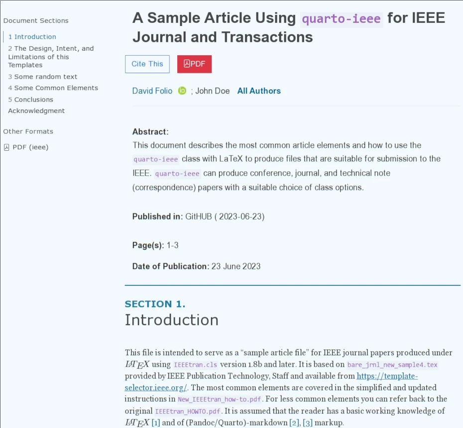

## PDF output improvements
In this new release, [`quarto-ieee`] template has improved the support of the [IEEEtran.cls] document class commands for the `PDF` output.
In particular, the `IEEEbiography` and `IEEEbiographynophoto` [IEEEtran.cls] environment is now supported.
But, it is better to use the `photo` and `bio` in the author metadata in the `YAML` front matter. In this way the `IEEEbiography`  is generated automatically.

Additionally, [`quarto-ieee`] template now supports the [`mhchem`](https://ctan.org/pkg/mhchem) (for chemical equation) 
and [`physics`](https://ctan.org/pkg/physics) (for flexible macros for typesetting equations) LaTeX packages.

See below an example of the `PDF` output:

:::center
[{width="80%"}](https://dfolio.fr/posts/quarto-ieee/template.pdf)
:::

:::callout-important
[`quarto-ieee`] use a hack to handle the `longtable` issue with  2-column LaTeX documents[^longtable].
In some cases, a page overflow may occur.
:::

[^longtable]: "_[longtable not compatible with 2-column LaTeX documents](https://github.com/jgm/pandoc/issues/1023>)_", see this issue <https://github.com/jgm/pandoc/issues/1023>

## HTML output support

In addition, now, the `HTML` output is supported.
In particular, [`quarto-ieee`] tries to mimic as closely as possible the article layout seen on [IEEEXplore®].
\
Most commands from [IEEEtran.cls] document class are supported.
However, some features are not (currently) supported:

- The default Quarto toc is used, so the display is not the same as on [IEEEXplore®].
- Footnote are put at the end of document, while on [IEEEXplore®] there are placed in the accordion.
- Figures are not placed in the accordion.
- [IEEEXplore®] specifics (e.g. citation metrics, etc.)
- The `HTML` output is a  [Quarto citeable article](https://quarto.org/docs/authoring/create-citeable-articles.html), so a citation appendix is automatically added to the article end.

See below an example of the `HTML` output:

:::center
[{width="80%"}](https://dfolio.fr/posts/quarto-ieee/template.html)
:::

### Contributing

If you want to improve the [`quarto-ieee`] template do not hesitate to submit [Pull Request](https://github.com/dfolio/quarto-ieee/pulls) (PR) (it is considered good practice to [open an issue](https://github.com/dfolio/quarto-ieee/issues) for discussion before working on a pull request for a new feature).

[quarto-journal]: https://github.com/quarto-journals/
[`quarto-ieee`]: https://github.com/dfolio/quarto-ieee/
[IEEEtran.cls]: https://ctan.org/pkg/ieeetran "Document class for IEEE Transactions journals and conferences"
[IEEEXplore®]: <https://ieeexplore.ieee.org/>

