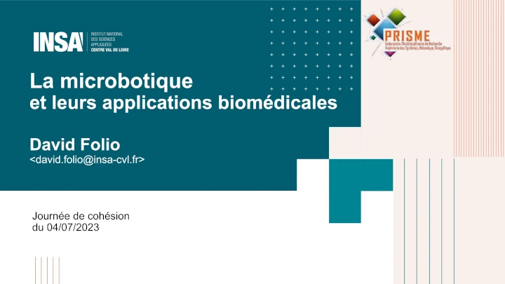

```{=html}
<object title="Slides of the talk" data="/pdf/publications/2023folio.pdf" type="application/pdf" width="100%" height="480" aria-labelledby="Talk PDF slides">
```
[](/pdf/publications/2023folio.pdf "Click to download PDF slides"){rel="nofollow" .download-link download="2023folio-slides.pdf"}
```{=html}
</object>
```


