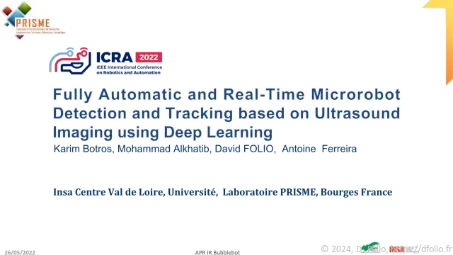

{rel="nofollow" .download-link download="2022botrosICRA-slides.pdf"} 

## Funding
This work was supported by the Region Centre Val de Loire Fund with the [BUBBLEBOT](/research/projects/BUBBLEBOT.qmd) project.

## See also

- [USMicroMagSet: Using Deep Learning Analysis to Benchmark the Performance of Microrobots in Ultrasound Images](../articles/2023botrosRAL.qmd)


