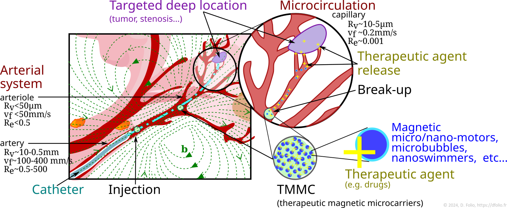

## Habilitation overview
 
In December 2021,I defended my Habilitation (in French "[Habilitation à diriger des recherches]{.fr lang="fr"}" -- HDR) in microrobotics. 
The title of my research work was ["_Magnetic Microrobotics for Biomedical Applications_"](#sec-details) [@folio2021hdr].
This manuscript summarizes my [teaching](https://dfolio.fr/teaching/) and [research](https://dfolio.fr/research/) activities since my recruitment as an associate professor in 2008.
\
Summarizing thirteen years of hard work is a valuable exercise. It provides an opportunity to reflect and identify the common thread that has motivated my personal and professional pursuits. It is important to acknowledge that these endeavors were the result of collaborative efforts, whether with colleagues, co-authors, or [students](https://dfolio.fr/research/supervision/)  under my  [supervision](https://dfolio.fr/research/supervision/). However, it is challenging to account for all the achievements so far, and I had to make some choices while writing my dissertation. Although other works are equally appealing, I aimed to maintain consistency in the manuscript. Specifically, in the second part, I focused on my primary scientific contributions concerning [**magnetic microrobots**](https://dfolio.fr/research/microrobotics/magnetic-microrobot/) that _[navigate through the cardiovascular system](https://dfolio.fr/research/microrobotics/biomedical/) for [biomedical applications](https://dfolio.fr/research/microrobotics/biomedical/)_.

{width=80% #fig-targeting .lightbox fig-alt="magnetic microrobot for targeted therapy"}

My research focus on modeling and controlling of microrobotic systems in a [biomedical context](https://dfolio.fr/research/microrobotics/biomedical/), as one illustrated in @fig-targeting.
Different research groups are working to develop solutions that can be applied to the human body.
So far, magnetic actuation  has emerged as the most suitable approach for these applications [@folio2012iros; @2015mellalIROS; @2022chenApplied].
The field of this original theme is still in progress with the ambition of modernizing current therapies by improving therapeutic targeting while enhancing patient comfort. To achieve this goal, it is important to have a good understanding of the microrobots that evolve in the human body [@2010belharetIROS; @folio2012iros].
The theoretical foundation and physical laws governing magnetic microrobots in vascular-like environments were studied [ @2015sarkisICRA;@2016jangACS; @2018sarkisJMEMS; @2013belharetISOT; @2022folioTCST; @2016mellalTNB; @2018mellalEncyclopedia; @2022mellalRAL; @2022wuAIS].
A methodology was developed to handle multiphysics approaches that combine different sources of uncertainties and hypotheses [@2013belharetTBME].
The validations were carefully conducted through experiments or numerical analysis when necessary.
This help us  to better understand the overriding dynamics, as well as the predominant parameters in the description of magnetic microrobots in a vascular-like environment.
This makes  possible to fully characterize their behaviors in  a viscous flow  and their responses to magnetic fields.
\
All of these helped us to propose advanced navigation strategies for our microrobots [@2012belharetBioRob; @2011belharetAdvRob; @2012belharetIROS; @2012belharetISOT; @dahmen2012iros; @2016mellalICRA].
Our navigation process can be divided in two levels. 
First, we plan (off-line) really feasible navigation paths based on the <abbr title="Fast Marching Method">FMM</abbr>. 
With the proposed navigation planning framework, we can take into account different constraints and objectives to get _a really feasible_ reference path.
Second, we synthesized control schemes that drive the magnetic microrobots along the reference to the targeted location.
To this aim, we have chosen to implement  predictive control  and optimal control laws.
\
All of our proposed models and navigation strategies were then evaluated through various experiments in different conditions.
To do so, various  proof-of-concept platforms were developed within the  and through our collaborations. 
To further extend the magnetic actuation capability, we have also extensively studied the design of  electromagnetic systems.
These <abbr title="Electromagnetic Actuation">EMA</abbr> platforms that meet properly the specifications of the biomedical operation would produce  magnetic fields and gradients more suited to the needs.
This knowledge allowed us to build the OctoRob platform.

## Habilitation Details {#sec-details}

I obtained my Habilitation in Robots Control from University of Orleans (France) on December 3, 2021, which was entitled: “_Magnetic Microrobotics for Biomedical Applications: Modeling, Simulation, Control and Validations_" [@folio2021hdr].

::: {.content-visible when-profile="quarto-pub"}
Manuscript (on quarto-pub)
:   [D. Folio](https://dfolio.fr/about/dfolio.html)' [Habilitation thesis](https://dfolio.fr/pdf/folio2021hdr.pdf "Click to download"){rel="nofollow" .download-link download="folio2021hdr.pdf"} 
    ([view](https://dfolio.fr/pdf/folio2021hdr.pdf "Click to view"){rel="nofollow" .download-link})
    
Slides
:   [D. Folio](https://dfolio.fr/about/dfolio.html)' [Habilitation defense slides](https://dfolio.fr/pdf/folio2021hdr-slides.pdf "Click to download"){rel="nofollow" .download-link download="folio2021hdr-slides.pdf"} 
    ([view](https://dfolio.fr/pdf/folio2021hdr-slides.pdf "Click to view"){rel="nofollow" .download-link})
:::
::: {.content-hidden when-profile="quarto-pub"}
Manuscript
:   [D. Folio](/about/dfolio.qmd)' [Habilitation thesis](/pdf/folio2021hdr.pdf "Click to download"){rel="nofollow" .download-link download="folio2021hdr.pdf"} 
    ([view](/pdf/folio2021hdr.pdf "Click to view"){rel="nofollow" .download-link})
    
Slides
:   [D. Folio](/about/dfolio.qmd)' [Habilitation defense slides](/pdf/folio2021hdr-slides.pdf "Click to download"){rel="nofollow" .download-link download="folio2021hdr-slides.pdf"} 
    ([view](/pdf/folio2021hdr-slides.pdf "Click to view"){rel="nofollow" .download-link})
:::
Defended
: the 3^rd^ December 2021
 
Committee
:   
    +-----------+------------------------------------------------------------------------------+
    | President | Chantal Pichon (Prof. des Université, Orléans)                               |
    +-----------+------------------------------------------------------------------------------+
    | Reviewers | Michaël Gauthier (DR, CNRS, FEMTO-ST, Besançon)                              |
    |           |                                                                              |
    |           | Sylvain Martel (Prof. Polytechnique Montréal, Canada)                        |
    |           |                                                                              |
    |           | Philippe Poignet (Prof. des Universités, Univ. Montpellier)                  |
    +-----------+------------------------------------------------------------------------------+
    | Examiners | Christine Prelle (Prof. des  Universités, UTC)                               |
    |           |                                                                              |
    |           | Mohammed Samer (Prof. des Universités, Univ. Paris-Est Créteil Val de Marne) |
    |           |                                                                              |
    |           | Li Zhang (Prof., Dept. MAE, CUHK, Hong Kong)                                 |
    +-----------+------------------------------------------------------------------------------+
    | Guarantor | Antoine Ferreira (Prof. des  Universités, INSA Centre Val de Loire)          |
    +-----------+------------------------------------------------------------------------------+

## References

::: {#refs}
:::
