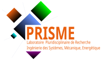
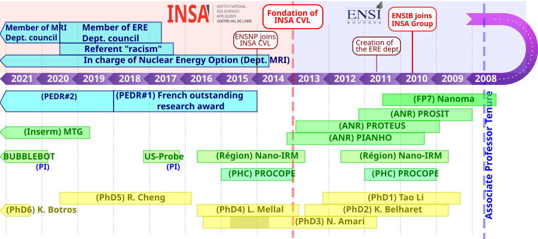

## Researches as Associate Professor {#sec-career-tenure}

:::{.grid}
:::{#INSA-CVL .d-none .d-md-block .g-col-md-8}
In 2008, I was recruited as Associate Professor at the Graduate Engineering
School (ENSI) of Bourges, which is now the [^1]. Since my tenure, I have been regularly
involved in the life of the Institute.
:::
:::{.d-none .d-md-block .g-col-md-4 }
{#fig:INSA-CVL}
:::
:::
[^1]: INSA [Centre Val de Loire]{.fr lang="fr"} (INSA CVL) was created in 2014 by the merge of [École Nationale d'Ingénieurs du Val de Loire]{.fr lang="fr"} (ENIVL) of Blois and [École Nationale Supérieur d'Ingénieurs]{.fr lang="fr"} (ENSI) of Bourges. 
lang="fr"} (ENSNP) of Blois is integrated to INSA [Centre Val de Loire]{.fr lang="fr"}. <http://www.insa-centrevaldeloire.fr>
    
:::{.grid}
:::{#PRISME .d-none .d-md-block .g-col-md-8 }
I perform my research activities with the [^2] in the
Robotics team of the Images, Robotics, Automatic control and Signal
(IRAuS) unit. Since I am an Associate Professor, my research interests
mainly deal with the modeling and control for nano and micro-robotics in
a biomedical context. 
:::
:::{.d-none .d-md-block .g-col-md-4 }
{#fig:PRISME}
:::
:::

It can be noticed that, since my [PhD degree](/research/thesis/), I had to apply a slight change on my research
topics to address the specificities of the microworld. Actually, in a
first time, my research activities have been mainly related with the
European [project NANOMA](/research/projects/#NANOMA)[^3]. This project consisted to design
microrobotic system for targeted drug delivery through the
cardiovascular system. In parallel, I have also contributed to the
development of micromanipulation activities of the laboratory. Firstly,
the micromanipulation tasks have been devoted for intra-cytoplasmic
applications. Next, this research activities have evolved to object
micromanipulation to be placed in the focus of a light beam within the
[^8] [project PIANHO](/research/projects/#PIANHO)[^4]. The different projects in which I have been
involved are reported in [Research Projects](/research/projects/). In
addition, I have directly [supervised](/research/supervisions/) the
works of 6 PhD students (with one still ongoing). I also had the
opportunity to follow the research works of 4 external PhD students.

[^2]: PRISME is from University of Orléans and from INSA [Centre Val de
    Loire]{.fr lang="fr"} (EA 4229). <http://www.univ-orleans.fr/PRISME>

[^3]: The NANOMA project is an European project funded under FP7 ICT
    2007.3.6, Micro/nanosystems, coordinated by Professor Antoine
    Ferreira, University of Orléans , PRISMEshort Laboratory. The NANOMA
    project aims at proposing novel controlled nanorobotic delivery
    systems which will be designed to improve the administration of
    drugs in the treatment and diagnosis of breast cancer.

[^4]: The PIANHO project is an  P3N (2009) project. The motivation of
    this project is to create a nanomanipulation platform capable of
    pick, hold and place nano-objects in the synchrotron radiation beam
    of the ESRF (Grenoble, France) via tuneable tool-object interaction.

:::{.center}

:::

### Structuring of Activities

One main objective of my scientific works is to study the behavior of
systems at the microscale to propose novel solutions to successfully
perform advanced and reliable microrobotic tasks, mainly devoted to
biomedical applications. In particular, a significant lack of knowledge
emerge on the appropriate understanding of the behaviors of [microrobots
in a biomedical](/research/microrobotics/) situation. It is in this
context that most of my scientific contributions have been made, since
my tenure as associate professor. Specifically, in this manuscript, I
have chosen to focus on **magnetic medical microrobots** for targeted
therapy. On the basis of my research works carried out in this field, it
appears three main themes that define my relevant contributions:

-   Topics #1: Modeling of magnetic microrobotic systems for biomedical
    applications;
-   Topics #2: Simulation and advanced navigation strategies;
-   Topics #3: Evaluation and development of proof-of-concept of
    magnetic microrobotic systems.

## Prior research activities: doctorate degree and post-doctorate {#sec:career:PhD}

I have defended [my PhD](/research/thesis) in Robotics in 2007 within
the Robotics, Action, and Perception (RAP) group of the Laboratory for
Analysis and Architecture of Systems[^5] (LAAS), CNRS[^6], under the
supervision of Viviane Cadenat, Associate Professor at Paul Sabatier
University of Toulouse, France. My PhD thesis dealt with the design of
multi-sensor based control strategies allowing a mobile robot to perform
vision-based tasks amidst possibly occluding obstacles.

[^5]: LAAS is a laboratory depending from the CNRS. <http://www.laas.fr>

[^6]: Form French National Center for Scientific Research, from French
    [Centre National de la Recherche Scientifique]{.fr lang="fr"}
    (CNRS), is the largest governmental research organization in France.
    <http://www.cnrs.fr>

Between 2007 and 2008, I joined the Lagadic team at Inria[^7]
Rennes-Bretagne Atlantique as a post-doctoral fellow on sensory control
for unmanned aerial vehicles. My postdoctoral fellow has been supported
by "*Sensory Control for Unmanned Aerial Vehicles*" (SCUAV) 
project. The main objective was to improve multi-sensor-based servoing
tasks for unmanned aerial vehicles. The idea was to design robust
control law that combine different sensory data directly at the control
level. Especially, I have contributed to the design of a new on-line
sensor self-calibration based on the sensor/robot interaction links.

[^7]: French Institute for Research in Computer Science and Automation,
    from French: [Institut national de recherche en informatique et en
    automatique]{.fr lang="fr"} (Inria).
    <https://www.inria.fr/centre/rennes>

[^8]: From French [Agence Nationale de la Recherche]{.fr lang="fr"}
    (ANR), which is the French National Agency for Research.
    <http://www.agence-nationale-recherche.fr>

