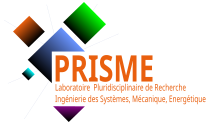
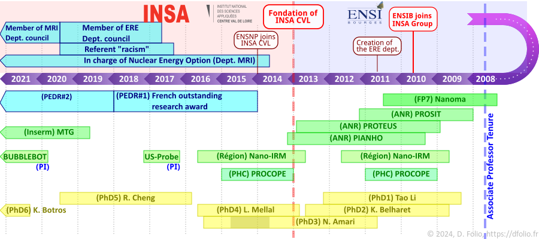
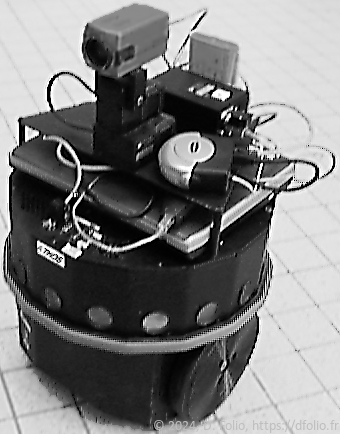
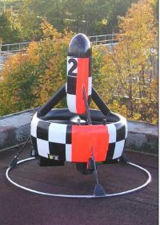

---
aliases:
  - /research/research.html
  - /research/research-activities.html
  - /research/activities.html
canonical: https://dfolio.fr/research/index.html
order: 2
date: 2018-03-27 15:17:09 +0200
title: "Research activities"
pagetitle: "David FOLIO research activities"
#subtitle: ''
keywords: [dfolio, research, activity]
toc: true
description: >
  An  overview of the career of D. Folio that sets the background in which its research works was carried out.
image: /images/logo-research.webp
image-alt: "research logo"
---

Further details [about me](../about/dfolio.qmd):

- [English version []{.text-danger}](/pdf/2023_dfolio_en.pdf "Click to download"){rel="nofollow" .download-link download="2023_dfolio_en.pdf"} 
  of [D. Folio' CV](/pdf/2023_dfolio_en.pdf "Click to download"){rel="nofollow" .download-link download="2023_dfolio_en.pdf"}  [(issued 2023)]{.text-muted}
- [Chinese version []{.text-danger}](/pdf/2018_dfolio_CN.pdf "Click to download"){rel="nofollow" .download-link download="2018_dfolio_CN.pdf"} 
  of [D. Folio' CV](/pdf/2018_dfolio_CN.pdf "Click to download"){rel="nofollow" .download-link download="2018_dfolio_CN.pdf"} [(issued 2018)]{.text-muted} [Thx Ruipeng]
- See also my 
  - [CV](https://cv.hal.science/david-folio){rel="noopener noreferrer" .url} from [ HAL](https://cv.hal.science/david-folio){rel="noopener noreferrer" .url}
  - [rapport d'activité  [fr]{.badge .rounded-pill .bg-primary}](/pdf/2022_rapport-activite.pdf){rel="nofollow" .download-link .fr lang="fr" download="2022_rapport-activite_dfolio.pdf"}  [(issued 2022)]{.text-muted}

## Researches as Associate Professor {#sec-career-tenure}

:::{.grid}
:::{#INSA-CVL .d-none .d-md-block .g-col-md-8}
In 2008, I was recruited as Associate Professor at the Graduate Engineering
School (<abbr lang="fr" title='École Nationale Supérieur d’Ingénieurs'>ENSI</abbr>) of Bourges, which is now the [^1]. Since my tenure, I have been regularly
involved in the life of the Institute.
:::
:::{.d-none .d-md-block .g-col-md-4 }
{fig-alt="INSA-CVL"}
:::
:::
[^1]:  (INSA CVL) was created in 2014 by the merge of 
      [École Nationale d'Ingénieurs du Val de Loire]{.fr lang="fr"} (ENIVL) of Blois and 
      [École Nationale Supérieur d'Ingénieurs]{.fr lang="fr"} (ENSI) of Bourges. 
      <http://www.insa-centrevaldeloire.fr>
    
:::{.grid}
:::{#PRISME .d-none .d-md-block .g-col-md-8 }
I perform my research activities with the [^2] in the
Robotics team of the Images, Robotics, Automatic control and Signal
() departement. Since I am an Associate Professor, my research interests
mainly deal with the modeling and control for [nano and micro-robotics](/research/microrobotics/index.qmd) in
a [biomedical context](/research/microrobotics/biomedical.qmd). 
:::
:::{.d-none .d-md-block .g-col-md-4 }
{fig-alt="PRISME"}
:::
:::

It can be noticed that, since my [PhD degree](/publications/thesis/folio2007thesis.qmd), I had to apply a slight change on my research
topics to address the specificity of the microworld. Actually, in a
first time, my research activities have been mainly related with the
European [project NANOMA](/research/projects/index.qmd#NANOMA). This project consisted to design
microrobotic system for targeted drug delivery through the
cardiovascular system. In parallel, I have also contributed to the
development of micromanipulation activities of the laboratory. Firstly,
the micromanipulation tasks have been devoted for intra-cytoplasmic
applications. Next, this research activities have evolved to object
micromanipulation to be placed in the focus of a light beam within the
[^8] [project PIANHO](/research/projects/index.qmd#PIANHO). 
The different projects in which I have been involved are reported in [Research Projects](/research/projects/index.qmd). 

[^2]: PRISME laboratory is from University of Orléans and from INSA [Centre Val de
    Loire]{.fr lang="fr"} (EA 4229). <http://www.univ-orleans.fr/PRISME>

:::{#fig-timeline}
{width=95% fig-alt="Timeline of my activities"}

Timeline of my activities.
:::

### Structuring of Activities

One main objective of my scientific works is to study the behavior of
systems at the microscale to propose novel solutions to successfully
perform advanced and reliable microrobotic tasks, mainly devoted to
biomedical applications. In particular, a significant lack of knowledge
emerge on the appropriate understanding of the behaviors of 
[microrobots](/research/microrobotics/index.qmd)  in a [biomedical situation](/research/microrobotics/biomedical/index.qmd).
 It is in this context that most of my scientific contributions have been made, since
my tenure as associate professor. 
Specifically, I have chosen to focus my research activities on **[magnetic microrobots](/research/microrobotics/magnetic-microrobot/index.qmd)** for [biomedical applications](/research/microrobotics/biomedical/index.qmd). 
On the basis of my research works carried out in this field, it
appears three main themes that define my relevant contributions:

- Topics #1: Modeling of[magnetic microrobotic](/research/microrobotics/magnetic-microrobot/index.qmd) systems for  [biomedical applications](/research/microrobotics/biomedical/index.qmd);
- Topics #2: Simulation and advanced navigation strategies;
- Topics #3: Evaluation and development of proof-of-concept of
  magnetic microrobotic systems.

These research activities were validated by my [Dr. Habil](/publications/thesis/folio2021hdr.qmd) in December 2021.

## Prior research activities: doctorate degree and post-doctorate {#sec:career:PhD}

I have defended [my PhD](/publications/thesis/folio2007thesis.qmd) in Robotics in 2007 within
the Robotics, Action, and Perception (<abbr lang="en" title="Robotics, Action, and Perception">RAP</abbr>) group of the Laboratory for
Analysis and Architecture of Systems[^5] (<abbr lang="en" title="Laboratory for Analysis and Architecture of Systems">LAAS</abbr>),
<abbr lang="fr" title="Centre National de la Recherche Scientifique">CNRS</abbr>[^6], under the
supervision of Viviane Cadenat, Associate Professor at Paul Sabatier
University of Toulouse, France. [My PhD thesis](/publications/thesis/folio2007thesis.qmd) 
dealt with the design of multi-sensor based control strategies allowing a mobile robot to perform
vision-based tasks amidst possibly occluding obstacles.

:::{#fig-mobile-robot layout=[30,-10,60]}
{#fig-scout fig-alt="Super scout"}

{#fig-aerial fig-alt="bertin"}

Mobile robots use (a) during my doctorate and  (b) in my post-doctorate.
:::

[^5]: LAAS is a laboratory depending from the CNRS. <http://www.laas.fr>

[^6]: Form French National Center for Scientific Research, from French
    [Centre National de la Recherche Scientifique]{.fr lang="fr"}
    (CNRS), is the largest governmental research organization in France.
    <http://www.cnrs.fr>

Between 2007 and 2008, I joined the Lagadic team at Inria[^7]
Rennes-Bretagne Atlantique as a post-doctoral fellow on sensory control
for unmanned aerial vehicles. My postdoctoral fellow has been supported
by "*Sensory Control for Unmanned Aerial Vehicles*" (SCUAV) 
project. The main objective was to improve multi-sensor-based servoing
tasks for unmanned aerial vehicles. The idea was to design robust
control law that combine different sensory data directly at the control
level. Especially, I have contributed to the design of a new on-line
sensor self-calibration based on the sensor/robot interaction links.

[^7]: French Institute for Research in Computer Science and Automation,
    from French: [Institut national de recherche en informatique et en
    automatique]{.fr lang="fr"} (Inria).
    <https://www.inria.fr/centre/rennes>

[^8]: From French [Agence Nationale de la Recherche]{.fr lang="fr"}
    (ANR), which is the French National Agency for Research.
    <http://www.agence-nationale-recherche.fr>
