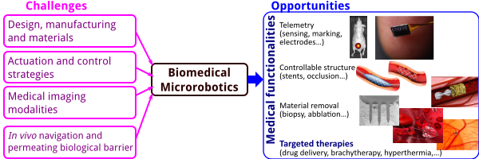

## Microrobotics for biomedical applications

Since the 1980s with the first surgical guidance robots, the use of robotic
systems in medicine and biomedical applications are growing, giving birth to the
"_medical robotics_" fields 
[@mack2001minimally; @gomes2012medical; @kroh2015essentials; @li2017micro; @simaan2018medical].
The motivations are mainly to reduce trauma, scarring, infection risks, postoperative pain, recovery time... and to
improve the quality of health-care by introducing the latest technological tools
from computer science and robotics in biomedical engineering [@kroh2015essentials].
These various advantages have made medical robot desirable for many types of procedures. 
Some medical robotics systems, which aimed at augmenting the practitioner capabilities and
reducing invasiveness, have already  been developed up to now [@kroh2015essentials; @troccaz2013medical; @hwang2020review]. 
For example, there are the well-known da Vinci® surgical assistance robots, developed by Intuitive Surgical[^daVinci],
which improves the surgeon technical skills, especially in minimally invasive
surgery (MIS) applications.
MIS procedures bring many advantages from reduction of
recovery time, medical complications and postoperative pain to increase quality
of care 
[@li2017micro; @simaan2018medical; @hwang2020review].
Historically, the medical robotics  topic is the main concern of the Robotics team
at the . 
For instance, researchers from the Robotics team have developed solutions like the robotized
tele-echography to provide skilled medical care to isolated
patients [@courreges2008robotized; @kumar2008teleradiology, @2016taoISJ].
Despite the widespread adoption today of medical robotic systems in clinical
activities, there are still important technical issues and
challenges [@li2017micro; @simaan2018medical; @yang2018grand].
Especially, the mechanical parts of existing medical robotic devices are still relatively large
and rigid to access and treat major inaccessible parts of the human body.
In parallel, the various medical robotic
solutions have helped to improve the acceptance of the use of robotic systems
in clinical practices. In the wake, microrobotics has also emerged as an
attractive technology to introduce novel microsystems to further reduce trauma,
create new diagnoses tools and therapeutic procedures.
The design of miniaturized and versatile robotic systems would allow access throughout the whole human body.
This would lead to new procedures down to the cellular level, and provide localized diagnosis and treatment with greater precision and efficiency.
For example, untethered minidevices can navigate within the body for targeted
therapies [@abbott2007robotics; @nelson2010microrobots; @sitti2009miniature].
This interest has been even more enhanced as some biomedical *minirobotic* solutions are already commercialized.
Swallowable endoscopic capsules are available clinically for gastrointestinal diagnosis.
Current research aims to explore different technologies to
extend these capabilities of such minidevices to the entire human body by
gaining access to areas that previously were unreachable or could only be
reached through open surgery [@nelson2010microrobots].
Examples of awaited biomedical applications are targeted drug delivery, material removal (e.g. biopsies), transport and placement of structures (e.g. stents or balloon),
telemetry/biosensors, and so on...
The manipulation of microrobots _in vitro_ and in the body of a living animal has been realized in recent studies 
[@gao2015artificial; @servant2015controlled; @felfoul2016magneto; @jeon2019magnetically]. 
For instance, in [@jeon2019magnetically] the authors report that magnetic microrobots
can be used to transport colorectal carcinoma cancer cells to tumor microtissue
in a body-on-a-chip, which comprised an _in vitro_ liver-tumor and micro-organ
network. The magnetic microrobots can also be controlled in a mouse brain slice
and rat brain blood vessel. Moreover, the potential of microrobots for the
culture and delivery of stem cells has been also demonstrated
[@li2017micro; @jeon2019magnetically]. These preliminaries biomedical
microrobots have demonstrated their enhanced tissue penetration and payload
retention capabilities.

:::{#fig-challenge}
{width=80%}

Challenges and opportunities of medical microrobots.
:::

It appears that microrobots for bio-engineering applications are very promising
solutions to improve healthcare with high scientific and societal impacts 
[@li2017micro; @yang2018grand; @abbott2007robotics; @nelson2010microrobots; @sitti2009miniature; @sitti2017mobile; @fatikow1997microsystem].
As an alternative to existing tethered solution (such as flexible endoscopes or
catheters) and passive drug carriers, mobile medical microrobots could directly access unprecedented
complex and tiny regions of the human body such as gastrointestinal,
cardiovascular network, brain, liver and so on. Such direct access capability
potentially opens up new means of medical interventions with minimal possible
tissue damage compared with the tethered catheters/endoscopes and incision-based
clinical procedures. Similarly, using active and controllable microrobots to
realize targeted local treatment, it is possible to minimize the side
effects while increasing the overall bio-availability of therapeutic agents, such as drugs,
imaging agents, genetic materials...
Active and targeted delivery of such therapeutic agents are the major motivations of the first
thought of biomedical microrobotic systems.
To this end, microrobots that are able to navigate inside the
human body to carry, deliver, and release therapeutics or perform advanced and
innovative biomedical tasks in semi or fully autonomous manners are envisioned
to revolutionize many clinical practices.
\
To do so, the ideal microrobot should be sufficiently autonomous and
capable to position itself, perform diagnosis with various sensing modalities,
localize itself accurately, transfer data and receive orders by wireless
communication, and perform medical intervention despite the environments
stimuli. Therefore, one of the scientific, technological and bio-ethical issues
is how to achieve all of this at the tiniest dimensions, where such features do
not exist today. To face these great challenges, many research teams are working in this field.

## References
:::{#refs}
:::

[^daVinci]: Intuitive Surgical Inc. <https://www.intuitivesurgical.com>, <http://www.davincisurgery.com/>
