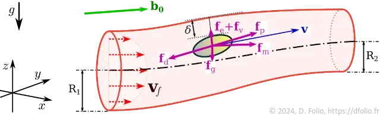

To develop reliable and efficient navigation strategies for magnetic  microrobots evolving in a vascular-like network 
the understanding of their behaviors and their interaction with their environment are important.

## Dynamic of magnetic microrobots in a microchannel {#chapIII-microrobot-model}

First, it is important to analyze the different interactions that exist between the magnetic microrobot and its environment. 
To this end, the fluid domain can be simply modeled by a cylinder of variable section, as
illustrated in @fig-model-vessel. 
The magnetic microrobot is then subjected to several vascular interaction forces [@abbott2007robotics;@arcese2012endovascular;@2013belharetTBME]. 
The dynamic model of a magnetic microrobot within a vascular-like system can be expressed from
Newton's second law expressed in the workspace reference frame:
$$
\begin{cases}
 M \dot{\vb{v}}       &= \sum \vb{f} =\vb{f}_a + \vb{f}_d + \vb{f}_{e}\\
 J \dot{\vb*{\omega}} &= \sum \vb{t} =\vb{t}_a + \vb{t}_d + \vb{t}_{e}
\end{cases}
$${#eq-Newton2}
where $M$ and $J$ are the mass and the moment of inertia of the microrobot, 
${\vb{v}}$ and $\vb*{\omega}$ are its linear and angular velocities.
$\vb{f}_{d}$ and $\vb{t}_{d}$ denote the fluid flow hydrodynamic drag force and torque,
$\vb{f}_{a}$ and $\vb{t}_{a}$ are the actuation force and torque (e.g. controlled electromagnetic field, catalytic self-propulsion...), and
$\vb{f}_{e}$ and $\vb{t}_{e}$ are the other external forces and torques.

:::{#fig-model-vessel}
{width=80% .lightbox fig-alt="magnetic microrobot in a vessel-like environment"}

Representation of a magnetic microrobot navigating in a vessel-like environment.
:::

@fig-model-vessel depicts some common forces for a microrobot navigating in vessel-like environment.
Various external disturbances can be considered in the above dynamic model  such as the weight ($\vb{f}_{g}$), electrostatic ($\vb{f}_{el}$), van der Waals ($\vb{f}_{v}$), contact or steric forces, and so on [@abbott2007robotics;@arcese2012endovascular;@2013belharetTBME].
However, away from the walls, the surface forces (e.g. electrostatic and the van der Waals microforces) quickly become negligible.
Similarly, as the size decreases, the weight becomes more negligible.
In most microscale cases, it can be assumed that $\vb{f}_{e}\approx0$ and $\vb{t}_{e}\approx0$,
and mainly the actuation force and the drag force are dominant.
