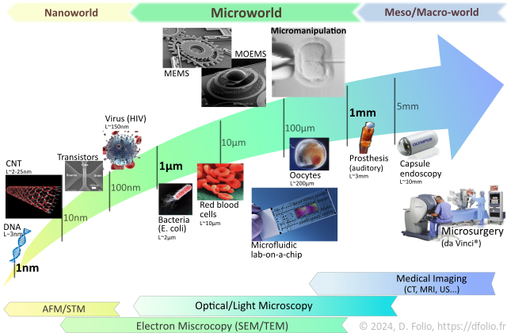

**Microbotics** is commonly referred to the branch of robotics, which
deals with the design, fabrication, control and application of miniature one.
The term can also be used for system capable of manipulating micrometer-sized components.
\
Microrobots are unique due to their small size, which enables them to navigate and interact in environments that are inaccessible to larger robots or human operators. They often utilize novel materials, fabrication techniques, and actuation mechanisms to overcome the challenges posed by the microscale.

::: {.callout-note}
While the '*micro*' prefix has been used subjectively to mean "small"[^micro],
standardizing on length scales should avoid confusion. A nanorobot
would have characteristic dimensions at or below $L<1$ [µm]{.unit},
or manipulate components on the $1$ to ${1000}$ [nm]{.unit} size range.
Similarly, a millirobot would have characteristic length
$L<1$ [cm]{.unit}; and a small-robot would have dimensions
$L<10$ [cm]{.unit}. Anything above the milli-scale is,
here, globally considered as a macroscale robot, where objects or
phenomena are large enough to be visible with the naked eye.

For the sake of clarity and simplicity the terms of
microrobot and microrobotic would refer mainly to systems that have
characteristic length globally of $L<1000$ [µm]{.unit} .
:::

[^micro]: The micro prefix comes from the Greek '[μικρός]{lang=grc .grc}'' ([mikrós]{lang=grc .grc}) meaning "small" (source: [wikipedia](https://en.wikipedia.org/wiki/Micro-)).

## Why using microrobots?

Since few decades, the societal, industrial and scientific issues related to more and more miniaturized objects or systems are of significant interests
[@fatikow1997microsystem; @nelson2008micro; @nelson2010microrobots; @sitti2009miniature; @sitti2017mobile].
These interests concern various domains such as healthcare, biotechnologies,
manufacturing, space, environment, power and so on, with the aims to
energy saving, mass reduction, lower CO~2~ release, etc. This
is made possible thanks to the advances in micro/nano-scale sciences and
technologies allowing creating tiny tools able to operate in very small
spaces, and to control or interact with micro/nano-scale entities efficiently. Such
smart small tools, which are referred globally in this manuscript as
"microrobots", enable a way to evolve directly in the
microworld; that is hardly conceivable with common macroscale robots or
any human abilities. Furthermore, the considered size together with the
advance in the fabrication process and materials design, enable low-cost
manufacturing in large numbers. These microrobots allow then considering
many new applications, such as innovation for diagnostics or therapies
(e.g. within the human body); microsystems for reliable
biotechnological tools; micromanufacturing enhancement; environmental
and health monitoring...
\
Before that, a good understanding of the considered small scale and its specificity is essential.

:::{#fig-scales}
{width=80% fig-alt="microrobotics scales"}

Representation of the scaling importance towards the microworld. The last rows report the relevant
imaging modalities.
:::

The abilities for the microrobots to manipulate or deal directly with
the  microworld are very promising, but still remains strongly challenging. 
Important issues are related to the understanding of the physics of the
microworld, the microrobots design and control strategies. 
Microrobotic appears as strongly multidisciplinary research fields
that includes physics and sciences from various fields, such as robotics,
micro/nano-technologies, control, mechanical engineering (e.g. classical, solid
and fluid mechanics), thermodynamic, electromagnetic, computer engineering,
artificial intelligence, and so on. 
The main specificities of working in the microworld are basically: 

- predominance of surface area related dynamics versus low volumic related dynamics,
- difficulties in obtaining direct data measurements (few sensory data, highly prone to noise...)
- difficulties in designing skillful microrobots embedding the most common robotic components (e.g. power, actuators, sensors, computing...). 

At the microscale  the governing laws remain unchanged.
However, as many dynamics usually rely on the size/length $L$ of the entities, their magnitudes and importance
change significantly while down-scaling  [@nelson2008micro]. 
To address this issue, one of our ambitions is to extend the understanding of the microworld physics, 
from a _"robotician"_ point of view.

In addition, the search for microrobotic systems that must always be smaller,
smarter, more versatile with more functionalities... still remains complex to
design, develop and control. All of these require the use of proper multiphysics
models and advanced navigation strategies (e.g. nonlinear, optimal, robust control schemes...). 
Moreover, such microrobots require efficient power supply, computational capabilities, tools
and features allowing manipulating and interacting directly with the microworld.

These various challenges associated with the lack of knowledge and tools are the main motivations of my research
works towards the realization of _advanced microrobotic tasks_. 
Our original approach aims to propose a framework spanning from the understanding of the microrobotic system and its environment, to the definition of their navigation strategies. 
Especially, in my research activities in focus mainly on [**biomedical applications**](biomedical/index.qmd).

