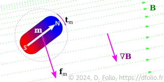
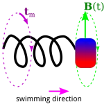
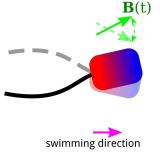

Commonly, the choice of the microrobots depends on the considered
procedure, as well as the targeted environments (networks: vascular, urinary,
nervous, or cavities: brain, eye, bladder, etc.). 
One most basic principle of
magnetic actuation relies on the use of the magnetic force, commonly referred as
_bead pulling_. 
Different shapes of microrobots exhibit various modes of operations when magnetic fields and
gradients are applied [@abbott2020magnetic], as illustrated in @fig-magnetic-actuation. 

:::{#fig-magnetic-actuation layout-ncol=3}
{#fig-magnetic-actuation-a fig-alt="bead pulling"}

{#fig-magnetic-actuation-b fig-alt="rotating magnetic"}

{#fig-magnetic-actuation-c fig-alt="oscillating magnetic"}

Schematic representation of basic magnetic swimming principle: (a) bead pulling with[^dB] $\grad{\vb{B}}$, (b) rotating magnetic field on helical microswimmer, and (c) oscillating magnetic field can be used to induce a traveling waves on flagella.
:::

[^dB]: The arrow that represents $\grad{\vb{B}}$ is there for the sake of clarity only. In no case $\grad{\vb{B}}$ is a 2D or 3D vector: it can indeed have up to 9 components...

##  Magnetic manipulation 
 
The basic principle of magnetic actuation is to manipulate microrobots with the
use of electromagnetic fields to induce forces and/or torques on it. Basically,
any magnetized objects can be subjected to forces and torques with an
externally-imposed electromagnetic field. The magnetic forces and torques
developed on a magnetized object are usually expressed as follows
[@jiles2015introduction;@griffiths2017introduction;@abbott2020magnetic]:
\begin{align}
\vb{f}_m &=V_m \ \left(\vb{M} \cdot \grad\right) \vb{B} \label{eq-Fm}\\ 
\vb{t}_m &=V_m \ \vb{M} \times  \vb{B} \label{eq-Tm}
\end{align}
where $V_m=\tau_m V$ is the volume of magnetic materials, with $V$ the total volume and $\tau_m$ the magnetization rate of the microrobot.
\
The magnetization $\vb{M}$ ([A/m]{.unit}) denotes the magnetic moment per unit volume 
due to any individual magnetic moments $\vb{m}$ existing in the material, that is:
$$
\vb{M} = \frac{1}{V_m}\sum_{V_m} \vb{m}
$$
According to Ampere's law, a magnet is equivalent to a circulating electric current.
The elementary magnetic moment $\vb{m}$ can be represented by a tiny current loop.
If the area of the loop is $S$, and the circulating current is $i$, then: $\vb{m}= i S$.

When a $\vb{B}$-field  ([T]{.unit}) passes through a magnetic material there can be some
ambiguity regarding which part of the field that origins from the external field and
which part that origins from the sample itself. It is then motivated to introduce
the auxiliary field[^magnetic-field] $\vb{H}$ ([A/m]{.unit}) as:
\begin{equation}
\vb{B}=\mu_0\left(\vb{H}+\vb{M}\right)=\mu\vb{H}\label{eq-BH}
\end{equation}

[^magnetic-field]: Some authors call $\vb{H}$ the magnetic field.  In fact, Sommerfeld [@sommerfeld1964electrodynamics, p45] opines that "The unhappy term 'magnetic field' for $\vb{H}$ should be avoided as far as possible" [@griffiths2017introduction].

In free space $\vb{M}=0$, that is outside a magnetic material $\vb{B}$ and $\vb{H}$ are almost identical, both fields point in the
same direction but differ in size by the factor $\mu$ which is the permeability for
the specific medium.
Inside any magnetic materials, there exists a relationship between $\vb{H}$ and $\vb{M}$, which depends on the [magnetic properties](magnetic-properties.qmd) of the material.

To actuate a microrobot, the magnetic field must either vary spatially (e.g. for bead pulling), or temporally (e.g. using a rotating or oscillating field), as illustrated in @fig-magnetic-actuation.
Bead pulling commonly used a strong magnetic gradient $\grad{\vb{B}}$ to steer magnetic microrobots.
Helical or flagellated microswimmers use a time varying magnetic field to control the propulsion torque \eqref{eq-Tm}.
It has been shown that helical microswimmers are
mainly efficient in arterioles or capillaries where the
Reynolds number ($\mathrm{R}_e<1$) remains small [@abbott2010how; @arcese2012endovascular;@peyer2013bioinspired].
In contrast,  bead pulling remains a more appropriate propulsion scheme in the arterial system [@arcese2012endovascular].

To maximize either the magnetic pulling
force \eqref{eq-Fm} or the torque \eqref{eq-Tm}, the microrobot should possess
strong magnetization $\vb{M}$, which depends on its [magnetic properties](magnetic-properties.qmd).

