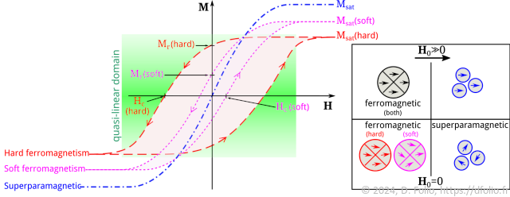

Any magnetic material will produce an $\vb{H}$-field both in the space around it
and within its own volume. The significance of this auxiliary field relies on
the relationship between $\vb{H}$ and its magnetization $\vb{M}$ that depends on the type of
material. Depending on their magnetic characteristics, materials can be
classified as [@jiles2015introduction;@furlani2001permanent]:

- Diamagnetic (Cu, C, H~2~, water...) materials that have a weak, negative susceptibility, and are lightly repelled by a magnetic field;
- Paramagnetic (Al, Na, O~2~...) materials that have a small, positive susceptibility, and are slightly attracted by a magnetic field;
- Ferromagnetic (Fe, Ni, Co...)  materials that have a large, positive susceptibility and exhibit a strong attraction to magnetic fields.
  
  :::{#fig-ferromagnetic}
  
  {fig-alt="Magnetization curves" width=90%}
  
  Magnetization curves of ferromagnetic and superparamagnetic material: ${M}_{r}$ is the remanent magnetization at $\vb{H}=0$, $H_{c}$ is the intrinsic coercivity, and  ${M}_{s}$  is the saturation magnetization. The right inset depicts the internal magnetic moment: when an external field $\vb{H}$ is applied all $\vb{M}$ are aligned in the same direction of $\vb{H}$. When $\vb{H}=0$ only ferromagnetic material hold a remanent magnetization  ${M}_{r}$.
  :::

For diamagnetic and paramagnetic materials, a relatively large applied field is required to produce
changes in magnetization; and there is no remanent magnetization if the applied
field is removed. For ferromagnetic materials, magnetization curves have a
typical hysteresis loop form, as represented in @fig-ferromagnetic, and 
there is no one-to-one relation between $\vb{H}$ and $\vb{M}$.
Inside diamagnets and paramagnets the $\vb{H}$-$\vb{M}$ relationship is
commonly linear given by:
$$\vb{M}=\chi\vb{H}$$
with $\chi$ the magnetic susceptibility.
\
Inside a magnetized sample, $\vb{M}$ gives also rise to a reversed field $\vb{H}_d$. This
field is called the _demagnetization-field_ (or the stray-field) and is expressed as:
$$\vb{H}_d = - \vb{N} \vb{M}$$
where $\vb{N}$ is the demagnetization-factor matrix which has values between 0 and 1 depending
on the shape of the sample. 
The internal field $\vb{H}_i$ is a function of the applied field $\vb{H}$, as well as a demagnetizing field produced by the
magnetization distribution of the sample itself:
$$\vb{H}_{i} = \vb{H} + \vb{H}_d$$
The relation between the magnetic field $\vb{B}$, the auxiliary field $\vb{H}$ and
the magnetization $\vb{M}$ of the medium can be then expressed as:
$$\vb{B}= \mu \vb{H}  = \mu_0 (1+\chi) \vb{H}$$

Furthermore, according to their coercivity[^Hc] $H_c$, ferromagnetic materials can be divided in two
groups: _soft_ and _hard_ magnets. 
Hard magnets, or permanent magnets, provide high coercivity, lower permeability and high hysteresis loop. 
While soft magnetic materials are easier to demagnetize after the saturation
state, the $H_c$ value is low and  $\chi$ value is high.
When the size of ferromagnetic particles are
small enough (e.g. ≲100 [µm]{.unit}) a _superparamagnetic_ behavior
occurs, and their magnetization appears to be in average zero when no field is
applied (i.e. $H_c\approx0$). 
Commonly, materials with a steep magnetization curve,  high saturation magnetization
${M}_{s}$ and low coercivity $H_{c}$ are commonly desired to be able to
work with minimal fields and gradients [@kim2013fabrication].

[^Hc]: Coercivity, or coercive force, is the strength of the applied magnetic field needed to bring the magnetic induction to zero. One may distinguish _coercivity_ that is the y-intercepts on the $\vb{B}$-$\vb{H}$ curve to _intrinsic coercivity_ $H_{ci}$ which is the y-intercepts on the M-H curve. For soft magnets, $H_c\approx H_{ci}$, whereas for hard magnets, the difference between $H_c$ and $H_{ci}$ can be very significant.

Initially, a ferromagnetic or superparamagnetic material consists of
magnetic domains with random orientation of their magnetic moment $\vb{m}$, as
represented in the inset in @fig-ferromagnetic. Applied magnetic
field leads to reorientation of magnetic moments towards its direction. When all
the moments are aligned with magnetic field, the magnetization saturation state
$\norm{\vb{M}}=M_{s}$ is reached. 
For hard magnetic materials the magnetization magnitude is usually independent of the external magnetic field
${\vb{B}}$, and could be considered easily saturated in most cases. In contrast,
for soft-ferromagnetic and superparamagnetic materials, ${\vb{M}}$ is strongly
related to ${\vb{B}}$. 
Hence, and as shown in magnetization curve in
@fig-ferromagnetic, two regions can be defined: a quasi-linear and
saturation domains. Depending on the magnetic field, the magnetization $\vb{M}$
will be either a function of  ${\vb{H}}$-field in the linear region, or constant
at saturation $\norm{\vb{M}}=M_{s}$. 
