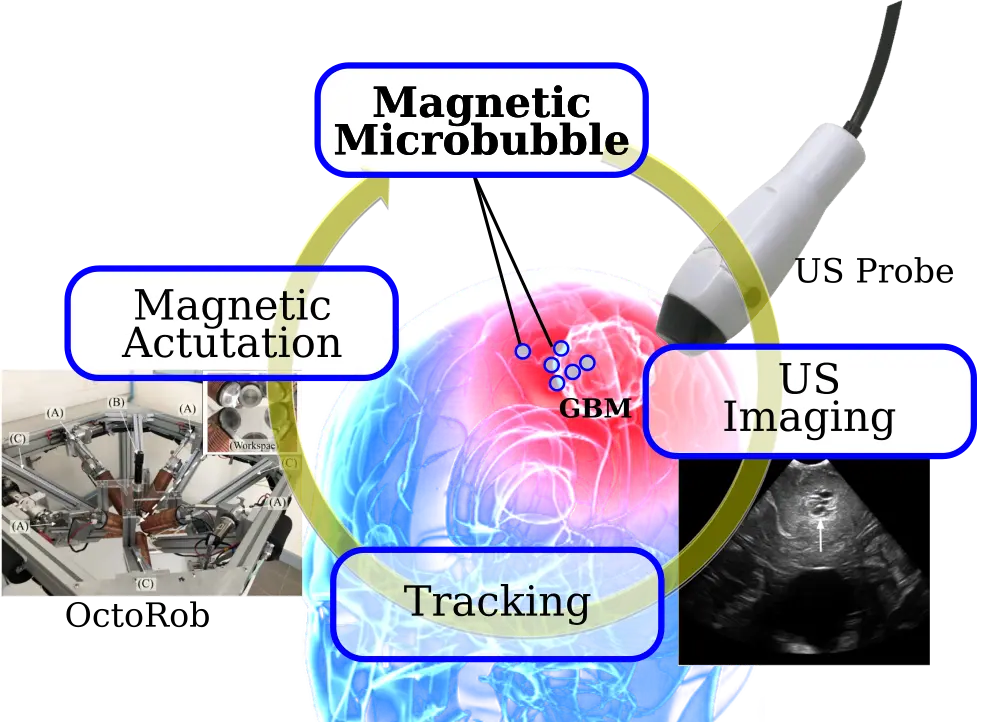

# Bubblebots to kill Glioblastoma 

The originality of the BUBBLEBOT project is to combine the progress made in microrobotics with those linked to the original microbubbles (MBs) developed in order to improve the therapeutic targeting of glioblastoma (GBM). To do this, these MBs encapsulating magnetic materials (that is the bubblebots) will be developed to be able to control their movements, their locations, and thus target the tumor area in a safe and efficient manner. 
This innovative interdisciplinary project brings together unique know-how in the production and magnetic guidance of bubblebots for therapeutic targeting. 

{width="80%"}

