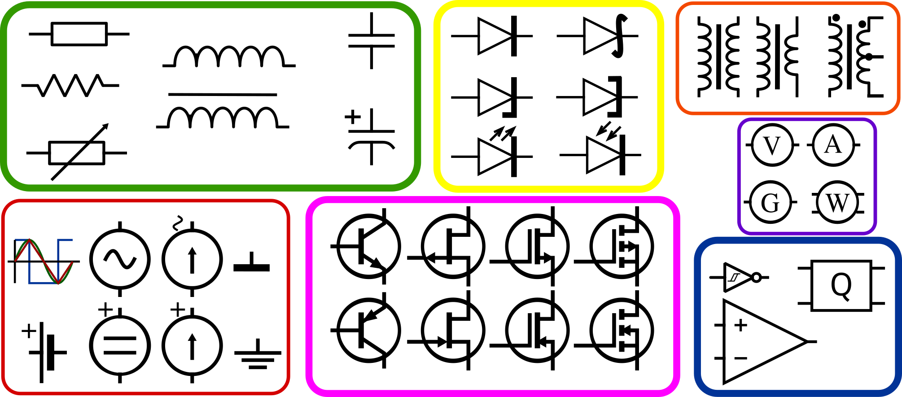

:::{.grid}
:::{.g-col-12 .g-col-xl-7 .teaching rules="groups"}
+----------------------+--------------------------------------------------+
| **STPI** _2A_        | **UE**: _SCIENCES APPLIQUEES ET INDUSTRIELLES 4_ |
+----------------------+--------------------------------------------------+
| **Semestre** _S4_    | **EC**: _Électronique analogique_                |
+----------------------+--------------------------------------------------+
| **ECTS**: 6          | _Tronc commun (TC)_                              | +----------------------+--------------------------------------------------+
| **Coefficient**: 2   |                                                  |
+----------------------+--------------------------------------------------+
:::
:::{.d-none .d-md-block .g-col-md-12 .g-col-xl-5}
{.zoom width="90%"}
:::
:::

## Objectifs pédagogiques {#sec-objectif}

Comprendre le fonctionnement des composants électroniques élémentaires à base de
semi-conducteurs, de leurs montages classiques, les étages amplificateurs en
particulier, et savoir dimensionner leurs éléments.

## Pré-requis

Afin de pouvoir appréhender le cours d'électronique analogique, il faut au
préalable maîtriser les enseignement d'électrocinétique 1 & 2 au programme
pédagogique de la 1^ère^ année <abbr lang=fr title="Sciences et Technologies pour l'Ingénieur">STPI</abbr>. 
Ces pré-requis comprennent, entre autre:

-   Les composants de base de l'électronique analogique:
    -   les dipôles passifs linéaires (e.g. résistances, condensateurs, inductances);
    -   et les dipôles actifs (e.g. les sources de tensions et de courant);
    -   mais aussi les quadripôles.
-   Les lois de Kirchoff (e.g. lois des nœuds, lois des mailles), les théorèmes _simplificateurs_ (eg. principe de superposition, théorèmes de Thévenin/Norton…);
-   Circuits linéaires en régime continu, transitoire et harmonique;
-   L'amplificateur électronique, et en particulier l'amplificateur opérationnel (AOP) idéal, etc.

## Programme du cours

-   La jonction PN et les diodes à semi-conducteurs et leurs applications,
-   Transistors bipolaires: caractéristiques et fonctionnement en régime statique – polarisation,
-   Transistors bipolaires en régime dynamique et montages amplificateurs,
-   Fonctionnement réel des amplificateurs opérationnels (AOP).

Le cours et les TD sont communs aux deux campus (de Blois et de Bourges) de
l'.

<ins class="adsbygoogle" style="display:block; text-align:center;" data-ad-layout="in-article" data-ad-format="fluid" data-ad-client="ca-pub-8144330076490130" data-ad-slot="8519706932"></ins>

## Supports {#sec-supports}

Vous avez ci-dessous les supports des cours et TD d'électronique analogique au format :

-   Support de [cours d'électronique analogique](/pdf/teaching/ELAN-book.pdf "Click to download"){.download-link download="ELAN-book.pdf"} 
-   Support de [TD d'électronique analogique](/pdf/teaching/ELAN-TD.pdf "Click to download"){.download-link download="ELAN-TD.pdf"} 
-   Ces supports sont également disponible sur Célène:  <https://celene.insa-cvl.fr/course/view.php?id=511>

