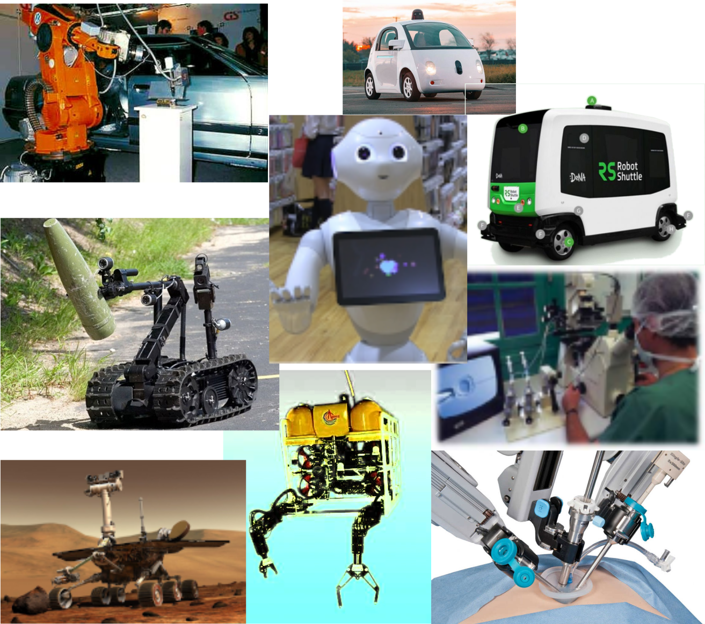

:::{.grid}
:::{.g-col-12 .g-col-xl-7 .teaching rules="groups"}
+----------------------+--------------------------------------------------+
| **MRI** _5A_         | **UE**: _Vision et mécatronique_                 |
+----------------------+--------------------------------------------------+
| **Semestre** _S6_    | **EC**: _Robotique avancée_                      |
+----------------------+--------------------------------------------------+
| **ECTS**: 10         | Option RSI \& STLR et Master                     |
+----------------------+--------------------------------------------------+
| **Coefficient**: 1   |                                                  |
+----------------------+--------------------------------------------------+
:::
:::{.d-none .d-md-block .g-col-md-12 .g-col-xl-5}
{.zoom width="90%"}
:::
:::

## Objectives {#sec-objectif}

The topic of this course would address the understanding of _advanced robotic_ with a particular attention to mobile robots, their structures and applications.
To do so, the parametric identification and the modeling (e.g. kinematics models) of robots are presented.
Next, their main mechatronic components (e.g. sensors and actuators) are described.
In a second part, the navigation and control of an autonomous mobile robot will be addressed.

## Skills to be achieved

- Being able to establish the kinematic modeling of robotics systems.
- Being able to identify and control an industrial robot and/or servicing robot.
- Being able to develop planning and localization algorithms.
- Being able to design autonomous robots.

## Outline {#sec-prog}

-  Introduction to mobile robotics
-  Modeling and kinematics;
-  Sensors and actuators for mobile robots
-  Localization and mapping
-  Autonomous navigation
-  Introduction to robots control

## Supports {#sec-support}

The course [handout material](/pdf/teaching/AdvancedRobotics.pdf "Click to download"){rel="nofollow" .download-link download="AdvancedRobotics.pdf"} of "**Advanced Robotic**" is available [here](/pdf/teaching/AdvancedRobotics.pdf "Click to download"){rel="nofollow" .download-link download="AdvancedRobotics.pdf"}, and the [tutorial materials](/pdf/teaching/AdvancedRobotics-TD.pdf "Click to download"){rel="nofollow" .download-link download="AdvancedRobotics-TD.pdf"} (TD) is available [here](/pdf/teaching/AdvancedRobotics-TD.pdf "Click to download"){rel="nofollow" .download-link download="AdvancedRobotics-TD.pdf"} .

