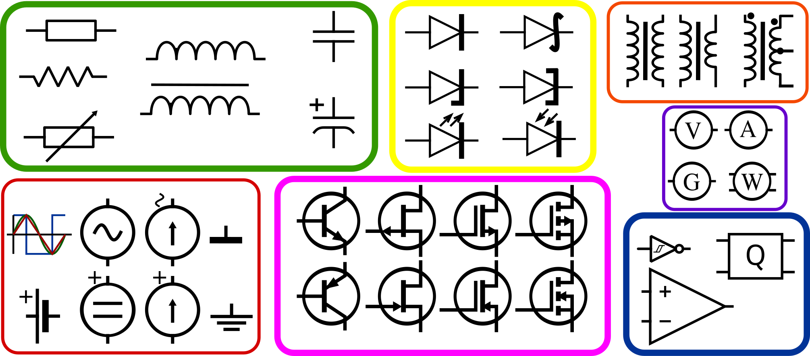

:::{.grid}
:::{.g-col-12 .g-col-xl-7 .teaching rules="groups"}
+----------------------+--------------------------------------------------+
| **MRI** _3A_         | **UE**: _SCIENCES DE L'INGÉNIEUR 5_              |
+----------------------+--------------------------------------------------+
| **Semestre** _S5_    | **EC**: _Composants électroniques_               |
+----------------------+--------------------------------------------------+
| **Crédits ECTS**: 10 | _Tronc commun (TC)_                              |
+----------------------+--------------------------------------------------+
| **Coefficient**: 2   |                                                  |
+----------------------+--------------------------------------------------+
:::
:::{.d-none .d-md-block .g-col-md-12 .g-col-xl-5}

:::
:::

## Objectifs pédagogiques {#sec-objectif}

Comprendre le fonctionnement des composants électroniques analogiques élémentaires, de leurs spécificités technologiques et de leurs caractéristiques _réelles_.
En particulier, il s'agit de pouvoir (re)connaître l'emploi de ces composants électroniques et de savoir les dimensionner.

## Pré-requis

Cet enseignement d'électronique analogique est un cours d'**électronique
avancée**. Il est donc important d'avoir certaines notions d'électronique
analogique. Afin de pouvoir appréhender le cours d'électronique analogique, il
faut donc au préalable avoir maîtrisé les
[enseignement d'électronique analogique](/teaching/ELAN/) ([ELAN](/teaching/ELAN.qmd)) au programme
pédagogique de la 2^nde^ année <abbr lang=fr title="Sciences et Technologies pour l'Ingénieur">STPI</abbr>. 
Ces pré-requis comprennent, entre autre:

-   Les lois de Kirchoff (e.g. lois des nœuds, lois des mailles), les théorèmes _simplificateurs_ (e.g. principe de superposition, théorèmes de Thévenin/Norton…);
-   Le comportement "_idéalisé_" des composants de base de l'électronique analogique, dont en particulier :
    -   les dipôles passifs linéaires (e.g. résistances, condensateurs, inductances);
    -   les bases des composants constitués de semi-conducteurs (e.g. diodes et transistors).
-   Circuits linéaires en régime continu, transitoire et harmonique;
-   L'amplificateur électronique, et en particulier l'amplificateur opérationnel (AOP) idéal, etc.

## Programme du cours

-   Technologies des composants électroniques passifs: linéaire (résistances, capacités, inductances) et non linéaire (les diodes)
-   Les transistors : caractéristiques et fonctionnement en régime statique – polarisation
    -   les transistors bipolaires,
    -   les transistors à effet de champs.
-   Technologies des composants numériques ;
-   Introductions aux composants de l'électronique de puissances.

<ins class="adsbygoogle" style="display:block; text-align:center;" data-ad-layout="in-article" data-ad-format="fluid" data-ad-client="ca-pub-8144330076490130" data-ad-slot="8519706932"></ins>

## Supports {#sec-supports}

Vous avez ci-dessous les supports des cours et TD de composants électroniques  au format :

-   Support de [cours de composants électroniques](/pdf/teaching/compElect-book.pdf "Click to download"){.download-link download="compElect-book.pdf"} 
-   Support de [TD de composants électroniques](/pdf/teaching/compElect-TD.pdf "Click to download"){.download-link download="compElect-TD.pdf"} 
-   Ces supports sont également disponible sur Célène: <https://celene.insa-cvl.fr/course/view.php?id=203>
