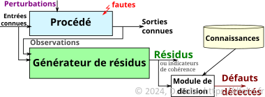

:::{.grid}
:::{.g-col-12 .g-col-xl-7 .teaching rules="groups"}
+----------------------+--------------------------------------------------+
| **MRI** _4A_         | **EA**: _Génie des Procédés 2_                   |
+----------------------+--------------------------------------------------+
| **Semestre** _S8_    | **EC**: _Diagnostic et systèmes industriels_     |
+----------------------+--------------------------------------------------+
| **ECTS**: 5          | _EA Génie des Procédés_                          |
+----------------------+--------------------------------------------------+
:::
:::{.d-none .d-md-block .g-col-md-12 .g-col-xl-5}
{.zoom width="90%"}
:::
:::

## Objectifs pédagogiques {#sec-objectif}

L'ambition de cet enseignement est de proposer une approche permettant
d'améliorer la fiabilité et la disponibilité des processus technologiques.  Cela
s'effectue, entre autre, par la mise en œuvre de systèmes de surveillance dont
l'objectif est d'être capable, à tout instant, de fournir l'état de
fonctionnement des différents organes constitutifs d'un système. Cette approche
considère les systèmes de production non seulement sous l'angle de leur commande
mais également sous leurs aspects sûreté de fonctionnement, maintenance, gestion
technique, diagnostic de fonctionnement.

## Pré-requis

Cet enseignement fait appel à la fois aux connaissance relatifs aux systèmes
physiques,  et donc à différents domaines de la physique (eg. mécanique,
thermodynamique, mécanique des fluides, etc.) et à leur automatisation. En
particulier, les outils de modélisation et d'analyse des systèmes sont des
préalables important, et sont présentés notamment dans les cours d'automatique
(3A-S6). Les enseignements de l'EC "**modélisation et commande dans l'espace
d'état**" (4A-S8) sont également exploités.

## Programme du cours {#sec-prog}

-   Généralité:
   -   Systèmes et Diagnostic
   -   Surveillance et Diagnostic
-   Diagnostic basée modèle
-   Etude de cas

## Supports {#sec-support}

Le [support cours](/pdf/teaching/diagSys-book.pdf "Click to download"){rel="nofollow" .download-link download="diagSys-book.pdf"}  de diagnostic des systèmes industriels est accessible [ici](/pdf/teaching/diagSys-book.pdf "Click to download"){rel="nofollow" .download-link download="diagSys-book.pdf"} au format .
