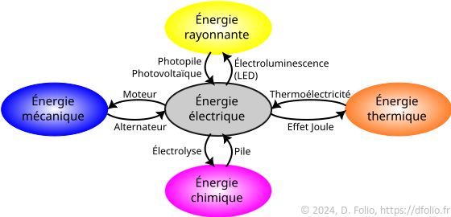

:::{.grid}
:::{.g-col-12 .g-col-xl-7 .teaching rules="groups"}
+----------------------+--------------------------------------------------+
| **ERE** _3A_         | **UE**: _Sciences Appliquées_                    |
+----------------------+--------------------------------------------------+
| **Semestre** _S6_    | **EC**: _Electricité - Électrotechnique_         |
+----------------------+--------------------------------------------------+
| **ECTS**: 5          | _Tronc commun (TC)_                              |
+----------------------+--------------------------------------------------+
| **Coefficient**: 2   |                                                  |
+----------------------+--------------------------------------------------+
:::
:::{.d-none .d-md-block .g-col-md-12 .g-col-xl-5}
{.zoom width="90%"}
:::
:::

## Objectifs pédagogiques {#sec-objectif}

Explorer les notions de base liées à l'électricité, à l'électrotechnique
(parfois appelé "_génie électrique_") et aux systèmes électriques de puissance.
Notamment, il s'agit d'explorer les domaines de l'électrotechnique ou le génie
électrique industriel qui est une partie de la physique qui concerne l'étude des
applications techniques de l'électricité.

## Pré-requis

Cet enseignement de base de l'ingénieur fait appel aux compétences élémentaires des apprentis, soit en particuliers:

-   les mathématiques (avec les grandeurs complexes),
-   quelques notions d'électromagnétisme et de mécanique.

Des notions d'électroniques, avec en particuliers les impédances, permet un
meilleur suivi de cet enseignement.

## Programme du cours {#sec-prog}

-   Notions de base de l'électricité (e.g. impédance complexe, puissance électrique, etc.);
-   Le régime monophasé et triphasé;
-   Le transformateur monophasé;
-   Les machines électriques tournantes: à courant continu, asynchrone, synchrone

<ins class="adsbygoogle" style="display:block; text-align:center;" data-ad-layout="in-article" data-ad-format="fluid" data-ad-client="ca-pub-8144330076490130" data-ad-slot="8519706932"></ins>

## Supports {#sec-supports}

Vous avez ci-dessous les supports  au format  :

-   Support de [cours d'électricité - électrotechnique](/pdf/teaching/electricite-book.pdf "Click to download"){rel="nofollow" .download-link download="electricite-book.pdf"} 
-   Support de [TD d'électricité - électrotechnique](/pdf/teaching/electricite-TD.pdf "Click to download"){rel="nofollow" .download-link download="electricite-TD.pdf"} 
