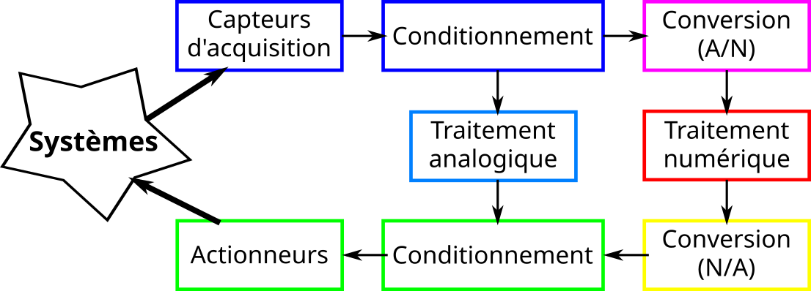

:::{.grid}
:::{.g-col-12 .g-col-xl-7 .teaching rules="groups"}
+--------------------+-+--------------------------------------------------+
| **MRI** _4A_         | **EA**: _Systèmes avancés 1_                     |
+----------------------+--------------------------------------------------+
| **Semestre** _S7_    | **EC**: _Signaux et Systèmes_                    |
+----------------------+--------------------------------------------------+
| **ECTS**: 10         | _EA Systèmes avancés_                            |
+----------------------+--------------------------------------------------+
:::
:::{.d-none .d-md-block .g-col-md-12 .g-col-xl-5}
{.zoom width="90%"}
:::
:::

## Objectifs pédagogiques {#sec-objectif}

Cet enseignement fait le point sur différentes notions fondamentales concernant
le traitement des signaux analogiques. Il présente les systèmes utilisés pour la
génération des signaux et leur traitement à l'émission comme à la réception.

## Pré-requis

Cet enseignement fait appel à la fois aux connaissance relatifs aux signaux (e.g. traitement du signal) et aux systèmes (e.g. automatique); mais aussi à d'autres domaines de la physique tels que la mécanique, mais surtout à l'électronique analogique.

## Programme du cours {#prog}

- Rappel des principes de base sur les signaux et les systèmes
- Le filtrage analogique
- Les oscillateurs 
- Boucles à verrouillage de phase (PLL)

## Supports {#supports}

Vous avez ci-dessous les supports des cours et TD de signaux et systèmes au format :

-   Support de [cours de signaux et systèmes](/pdf/teaching/sigSys-course.pdf "Click to download"){rel="nofollow" .download-link download="sigSys-course.pdf"} 
-   Support de [TD de signaux et systèmes](/pdf/teaching/sigSys-tutorial.pdf "Click to download"){rel="nofollow" .download-link download="sigSys-tutorial.pdf"} 
-   Ces supports sont également disponible sur Célène:  <https://celene.insa-cvl.fr/course/view.php?id=13>

:::{.callout-note}
Cet enseignement fait aussi partie du master  de physique fondamentale "[Physique Appliquée et Ingénierie Physique](https://www.insa-centrevaldeloire.fr/fr/formation/master)" de l'.
Ce master accueil des étudiants internationnaux, les supports sont donc en langue anlaise.
:::

