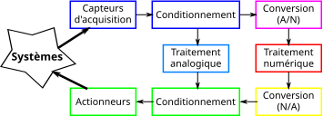

:::{.grid}
:::{.g-col-12 .g-col-xl-7 .teaching rules="groups"}
+---------------------+--------------------------------------------------+
| **MRI** _4A_        | **EA**: _Systèmes avancés 2_                     |
+---------------------+--------------------------------------------------+
| **Semestre** _S8_   | **EC**: _Signaux et Systèmes_                    |
+---------------------+--------------------------------------------------+
| **Crédits ECTS**: 8 | _Parcours 4A MRI Systèmes Avancés_               |
+---------------------+--------------------------------------------------+
:::
:::{.d-none .d-md-block .g-col-md-12 .g-col-xl-5}

:::
:::

## Objectifs pédagogiques {#objectif}

Cet enseignement fait le point sur différentes notions fondamentales concernant
le traitement des signaux analogiques. Il présente les systèmes utilisés pour la
génération des signaux et leur traitement à l'émission comme à la réception.

## Pré-requis

Cet enseignement fait appel à la fois aux connaissance relatifs aux signaux (e.g. traitement du signal) et aux systèmes (e.g. automatique); mais aussi à d'autres domaines de la physique tels que la mécanique, mais surtout à l'électronique analogique.

## Programme du cours {#prog}

-   Le filtrage analogique, avec:
   -   la synthèse des filtres passifs,
   -   la synthèse des filtres actifs,
-   Les oscillateurs :
   -   généralités et les oscillateurs sinusoïdaux (eg. principe de fonctionnement, critère de
Barkhausen, etc.),
   -   les oscillateurs à résistances négatives,
   -   les oscillateurs à réaction positives
   -   les résonateurs
-   Boucles à verrouillage de phase (PLL):
   -   généralité et principe de fonctionnement des PLL,
   -   le comparateur de phase,
   -   analyse dynamique de la PLL

## Supports {#supports}

Vous avez ci-dessous les supports des cours et TD de signaux et systèmes au format :

-   Support de [cours d'électronique analogique](/pdf/teaching/sigSys-book.pdf "Click to download"){.download-link download="sigSys-book.pdf"} 
-   Support de [TD d'électronique analogique](/pdf/teaching/sigSys-TD.pdf "Click to download"){.download-link download="sigSys-TD.pdf"} 
-   Ces supports sont également disponible sur Célène:  <https://celene.insa-cvl.fr/course/view.php?id=13>

